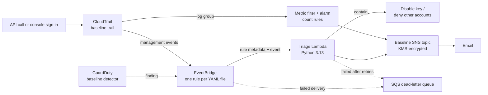

# Detection-as-Code on AWS


I ran real attacker techniques against my own AWS account with Stratus Red
Team, wrote a detection for each one as a YAML file mapped to MITRE ATT&CK,
deployed them with Terraform, and built a Python Lambda that alerts on every
detection and automatically contains two of them. Every detection has a test
that replays the real event it was built from.

Builds on [cloud-security-baseline](https://github.com/Anikate2212/cloud-security-baseline),
which provides CloudTrail, GuardDuty, the alert topic and the budget.

## Problem

CloudTrail and GuardDuty record attacks, but a log nobody reads is not a
detection. A small team needs to know within seconds when someone creates a
backdoor key, opens a bucket to another account or stops logging. Those
rules should be reviewed, tested and versioned like any other code, not
clicked together in a console where nobody can tell what changed.

## Architecture



- **Single-event rules** (5 of 6): an EventBridge pattern sends the event to
  the triage Lambda, which writes one JSON log line, contains if the rule
  says so, and publishes a readable alert.
- **Count rule** (Secrets Manager mass read): one `GetSecretValue` is normal,
  forty in five minutes is not. A CloudWatch Logs metric filter on the
  trail's log group plus an alarm.
- Adding a detection means adding a YAML file. Terraform reads
  `detections/*.yml` and builds the rule, target and permission, or the
  metric filter and alarm.

## Detections

| Detection | ATT&CK | Source | Response | Proven by |
|---|---|---|---|---|
| [cloudtrail-stop-logging](detections/cloudtrail-stop-logging.yml) | T1562.008 Disable or Modify Cloud Logs | CloudTrail | notify | Stratus |
| [iam-backdoor-access-key](detections/iam-backdoor-access-key.yml) | T1098.001 Additional Cloud Credentials | CloudTrail | **contain**: set the new key Inactive | Stratus |
| [ec2-instance-credential-exfiltration](detections/ec2-instance-credential-exfiltration.yml) | T1552.005 Cloud Instance Metadata API | GuardDuty | notify | GuardDuty sample finding only |
| [secretsmanager-mass-read](detections/secretsmanager-mass-read.yml) | T1555.006 Cloud Secrets Management Stores | CloudTrail (count) | notify | Stratus |
| [s3-bucket-policy-external-access](detections/s3-bucket-policy-external-access.yml) | T1537 Transfer Data to Cloud Account | CloudTrail | **contain**: Sid-tagged Deny, Block Public Access | Stratus |
| [console-login-without-mfa](detections/console-login-without-mfa.yml) | T1078.004 Cloud Accounts | CloudTrail sign-in | notify | Stratus |

Each file holds the pattern, the expected log evidence, false-positive notes
and the response. Schema: [detections/README.md](detections/README.md).

The EC2 technique needs a NAT gateway. I skipped that live run to keep the
project at zero spend, so the rule stays `status: draft`. Its routing, alert
and replay tests are proven with a real GuardDuty sample finding, but I have
not seen GuardDuty raise this finding from credentials I stole myself.

## Threat model

[docs/threat-model.md](docs/threat-model.md): what is protected, what each
detection covers, and the gaps I know about.

## Incident walkthrough: backdoor access key (T1098.001)

**1. Attack.** Stratus Red Team, acting as an attacker with IAM write access,
creates a new IAM user and an access key for it. This is a classic way to
keep access after the original credentials are rotated.

```
AWS_REGION=us-east-1 stratus detonate aws.persistence.iam-backdoor-user
```

**2. Evidence.** CloudTrail records `CreateAccessKey` at 16:45:47 UTC on
2026-11-26. `requestParameters.userName` (who receives the key) differs from
`userIdentity.arn` (who made the call), and that difference is the backdoor.
Redacted event: [tests/events/iam-backdoor-access-key.json](tests/events/iam-backdoor-access-key.json).

**3. Detection.** IAM events reach EventBridge in us-east-1. The rule matches
every successful `CreateAccessKey`:

```yaml
event_pattern:
  source: ["aws.iam"]
  detail-type: ["AWS API Call via CloudTrail"]
  detail:
    eventSource: ["iam.amazonaws.com"]
    eventName: ["CreateAccessKey"]
    errorCode: [{ "exists": false }]
```

A pattern cannot compare two fields, so "created for someone else" is
decided in the Lambda.

**4. Containment.** The Lambda sees that the caller is not the key's owner
and the owner is not a protected admin, and calls `iam:UpdateAccessKey` with
`Status=Inactive`. Inactive, not deleted: the key stays for forensics and the
action is reversible with one command, which the alert includes:

```
aws iam update-access-key --user-name <user> --access-key-id <key> --status Active
```

Two layers stop containment from locking out the operator. The code skips
protected users, and the Lambda's IAM role has an explicit Deny on
`iam:UpdateAccessKey` for them, so even a bug cannot disable an admin's key.

**5. Alert.** Email subject `[HIGH] [CONTAINED] T1098.001 Access key created
for another IAM user`, with the actor, source IP, target user, key ID and the
undo command.

**6. Verification.** `aws iam list-access-keys` for the Stratus user showed
the key as `Inactive`. `aws events test-event-pattern` against the deployed
rule returned `true` for the captured event and `false` for a modified copy
that must not match. Then `stratus cleanup`.

## Design decisions and trade-offs

- **EventBridge + Lambda for single events, metric filters for counts.**
  EventBridge carries the full event within seconds, while an alarm carries
  only a number. Measured on the same console sign-in: this project's rule
  alerted at 17:29:49 UTC, 1 second after the sign-in, naming the user, IP
  and `MFAUsed: No`. The baseline's CIS metric-filter alarm for the same
  thing fired at 17:31:20, about 90 seconds later, saying only "1
  datapoint". Counting needs a time window, which EventBridge does not have,
  so the Secrets Manager rule is still a metric filter. The cost is that its
  alarm says how many reads happened, not who, so the responder runs the Logs
  Insights query below.
- **Rules target my Lambda, not the baseline SNS topic.** The baseline topic
  is KMS-encrypted and its policy only allows CloudWatch. Instead of editing
  the baseline, the Lambda's role is granted publish plus the key, with
  `kms:ViaService` limited to SNS.
- **Containment is reversible and narrow.** Keys are set Inactive, never
  deleted. Bucket containment only acts on buckets tagged
  `detection-demo=true`, adds one Deny statement with a fixed Sid, and keeps
  the attacker's statement as evidence. Everything else gets an alert only.
- **Logic that compares fields lives in code.** "Key created for another
  user" and "policy names another account" cannot be EventBridge patterns, so
  the rule is broad and the Lambda decides, with a unit test for each branch.
- **The Lambda ignores its own writes.** Writing a bucket policy emits a new
  `PutBucketPolicy` that matches the rule again. The Lambda skips events
  whose caller is its own session and logs the skip. The risk is that anyone
  who can assume the Lambda's role could change bucket policies without an
  alert, so that role is the most sensitive identity in the project.
- **Tests replay real events.** Fixtures are captured from the real
  simulation and redacted by [tools/make_fixture.py](tools/make_fixture.py):
  this account becomes `123456789012`, any other account `111122223333`, and
  keys, public IPs and GuardDuty geolocation are replaced. The tool refuses
  to write if the account ID survives. Hand-written events would only prove
  the pattern matches what I think AWS sends.
- **No AWS credentials in CI.** CI runs fmt, validate, Checkov, gitleaks and
  the replay tests. Live checks (`aws events test-event-pattern`,
  `aws logs test-metric-filter`) run locally.

## Test evidence

All times UTC, 2026-11-26.

| Detection | Simulated | Detected | Notes |
|---|---|---|---|
| cloudtrail-stop-logging | StopLogging 16:39:42 | Lambda log 16:39:43.8 | email about a minute later |
| iam-backdoor-access-key | CreateAccessKey 16:45:47 | `[CONTAINED]` email | key `Inactive`, checked in IAM |
| secretsmanager-mass-read | Stratus 16:51:38 | alarm 16:54:26 on 40 reads (threshold 10 in 5 min) | half the reads were Terraform, see lessons |
| ec2-instance-credential-exfiltration | GuardDuty sample finding 17:06:24 | EventBridge 17:06:28, email within a minute | live run skipped (cost) |
| s3-bucket-policy-external-access | PutBucketPolicy 17:22:44 | `[CONTAINED]` email | Deny statement checked on the bucket; own write skipped |
| console-login-without-mfa | sign-in 17:29:48 | 17:29:49 | baseline CIS alarm: 17:31:20 |

- 70 tests pass locally (5 skipped by design, for example a count rule has no
  event pattern to replay). CI has been green on every push since run #3.
- Spend for the whole project so far: $0.52 of a $10 budget, with a $1
  zero-spend alert active before the first simulation.

Logs Insights query to find who read the secrets (follow-up for the count
rule), run on the trail's log group:

```
fields @timestamp, userIdentity.arn, userAgent, requestParameters.secretId
| filter eventSource = "secretsmanager.amazonaws.com" and eventName = "GetSecretValue"
| stats count(*) as reads by userIdentity.arn, userAgent
| sort reads desc
```

## Deploy and destroy

Prerequisite: cloud-security-baseline applied in the same account, in
us-east-1. Copy `terraform/terraform.tfvars.example` to `terraform.tfvars`
and set the baseline's KMS key ID (the file is gitignored).

```bash
cd terraform
terraform init
terraform plan -out=tfplan
terraform apply tfplan
```

Tear down this project (the baseline is untouched):

```bash
AWS_REGION=us-east-1 stratus cleanup --all   # removes anything Stratus left behind
cd terraform && terraform destroy
```

`terraform destroy` removes the rules, Lambda, dead-letter queue, metric
filter and alarm. The Lambda's log group is managed by Terraform and is
deleted too, so export any evidence first.

## Lessons learned

- **My own tooling was the noisiest attacker.** The Secrets Manager alarm
  counted 40 reads: 20 from Stratus and 20 from Terraform refreshing its
  state, both as the same IAM user. A separate deploy role would let the rule
  tell a pipeline from a person. The baseline's CIS IAM alarm also fired on
  my own applies for the same reason.
- **Patterns cannot compare fields.** Two of six detections needed code to
  decide, which is why the Lambda has unit tests for every branch.
- **Containment can trigger its own detection.** I found this by thinking
  through the bucket case before the live run, and the fix (skip the
  Lambda's own session) has its own test.
- **Redaction needs two placeholders.** Mapping every 12-digit number to one
  fake account would have hidden the outside account in the S3 evidence.
- **Scanners differ by version.** CI's gitleaks 8.24 flagged a placeholder
  that local 8.30 allowed. I fixed it with an anchored allowlist instead of
  rewriting history.

## Repository layout

```
detections/               # one YAML rule per detection (source of truth)
src/triage/handler.py     # triage and containment Lambda
terraform/
├── main.tf               # looks up baseline resources, wires the modules
└── modules/
    ├── responder/        # Lambda, IAM role, log group, dead-letter queue
    └── detections/       # YAML -> EventBridge rules or metric filters + alarms
tests/                    # schema, replay, Lambda and redaction tests
tests/events/             # redacted real events, one per detection
tools/make_fixture.py     # turns a real event into a redacted fixture
docs/                     # plan, threat model
.github/workflows/ci.yml  # fmt, validate, checkov, gitleaks, tests
.pre-commit-config.yaml   # terraform fmt on commit, gitleaks on push
.gitleaks.toml            # default rules + AWS account ID rule
```

## Local setup

```bash
python3 -m venv .venv && .venv/bin/pip install -r requirements-dev.txt
pre-commit install          # terraform fmt on commit, gitleaks on push
.venv/bin/pytest -q tests
```

## License

MIT
