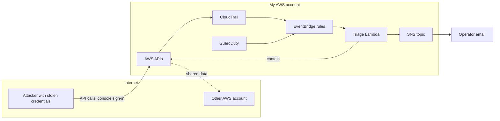

# Threat model

Scope: one AWS account (personal lab) with the cloud-security-baseline
deployed, plus this project's detections and triage Lambda, all in
us-east-1. The attacker is anyone who has obtained some AWS credentials in
the account: a leaked access key, a stolen instance role session, or a
console password.

## What is protected

| Asset | Why it matters |
|---|---|
| IAM identities and keys | Whoever controls them controls the account |
| Audit trail (CloudTrail) | Every detection here depends on it |
| Secrets in Secrets Manager | Credentials to other systems |
| S3 data | The usual exfiltration target |
| Instance role credentials | Usable from anywhere until they expire |
| This project's Lambda role | Can change bucket policies and disable keys |

## Trust boundaries

The boundaries that matter: credentials crossing from the internet into the
account, data crossing from the account to another account, and the Lambda,
which is the only automated identity allowed to change other resources.

## Attack path and coverage

The techniques follow one plausible attack, from getting in to keeping
access to taking data.

| Stage | Technique | ATT&CK | Detection | Response |
|---|---|---|---|---|
| Initial access | Console sign-in with a password, no MFA | T1078.004 | console-login-without-mfa | notify |
| Credential access | Instance role keys used outside the instance | T1552.005 | ec2-instance-credential-exfiltration (GuardDuty) | notify |
| Credential access | Read many secrets quickly | T1555.006 | secretsmanager-mass-read (count) | notify |
| Persistence | Create an access key for another user | T1098.001 | iam-backdoor-access-key | contain: key Inactive |
| Defense evasion | Stop or delete the trail | T1562.008 | cloudtrail-stop-logging | notify |
| Exfiltration | Grant another account access to a bucket | T1537 | s3-bucket-policy-external-access | contain: Sid Deny / Block Public Access |

Containment is limited to the two cases where the action is safe to reverse
and unlikely to break a real workload. The others alert only, and each rule
file explains why.

## Known gaps

Listed so a reviewer knows what this does not catch, not hidden.

- **One Region.** The rules run in us-east-1. IAM and console sign-in
  events land there, so those are covered everywhere, but S3, Secrets
  Manager and CloudTrail changes in other Regions are not. Fix: deploy the
  detections module per Region, or forward events to us-east-1 with
  cross-Region EventBridge rules.
- **The detection pipeline itself.** Deleting or disabling an EventBridge
  rule, the Lambda, or the GuardDuty detector is not detected by this
  project. cloudtrail-stop-logging covers the trail only.
- **Dead-letter queue has no alarm.** If the Lambda fails after retries the
  event lands in SQS, but nobody is told. Fix: an alarm on
  `ApproximateNumberOfMessagesVisible > 0`.
- **Batch secret reads.** `BatchGetSecretValue` is not counted by the
  Secrets Manager rule. Whether it also logs per-secret `GetSecretValue`
  events is unverified.
- **EC2 credential theft is unproven live.** Only a GuardDuty sample finding
  was routed; the live run was skipped to avoid NAT gateway cost. GuardDuty
  also takes minutes to raise this finding, much slower than the CloudTrail
  rules.
- **Federated and Identity Center sign-ins** report MFA differently and are
  out of scope for the MFA rule.
- **Count thresholds are untuned.** 10 reads in 5 minutes is a lab value; my
  own Terraform runs produced 20.
- **Single alert channel.** Email only. A deleted subscription or a full
  inbox silences everything.

## Risks this project adds

- **The Lambda role is powerful.** It can disable IAM keys and rewrite
  bucket policies on any bucket. Mitigations: actions limited to five S3 and
  one IAM write action with no deletes, an explicit Deny protecting admin
  users, and the tag check before any S3 write. The S3 tag check is in code
  only; IAM cannot express it for these actions.
- **The own-write exception.** The Lambda ignores `PutBucketPolicy` events
  made by its own session so that it does not alert on its own containment.
  Anyone who can assume that role can change bucket policies silently. The
  role trusts only the Lambda service, and every skip is logged.
- **Automated containment can be abused.** An attacker who knows the rules
  could create a key for a legitimate user to get it disabled. Impact is
  limited because the action is reversible, protected admins are exempt,
  and the alert carries the undo command.
- **Logs hold evidence.** The Lambda log group keeps raw events for a year,
  encrypted with the baseline KMS key. Fixtures in git are redacted, and
  gitleaks with an account-ID rule runs before every push and in CI.
